<div align="center">

# KAWAN: Your Mental Health Companion

**The user-facing web app of KAWAN: AI chat, mood check-ins, live counselling, e-books, meditation and games.**

*"Kawan" means **friend** in Malay.*

[](https://get-kawan.vercel.app)
[](https://react.dev)
[](https://vitejs.dev)
[](https://tailwindcss.com)
[](https://firebase.google.com)
[](https://www.videosdk.live)

</div>

---

## Table of Contents

- [Overview](#overview)
- [Live Demo](#live-demo)
- [Screenshots](#screenshots)
- [Features](#features)
- [Tech Stack](#tech-stack)
- [Architecture](#architecture)
- [Key Flows](#key-flows)
- [Routes](#routes)
- [Project Structure](#project-structure)
- [Getting Started](#getting-started)
- [Environment Variables](#environment-variables)
- [Deployment](#deployment)
- [Troubleshooting](#troubleshooting)
- [Known Limitations](#known-limitations)
- [Related Repositories](#related-repositories)
- [License](#license)
- [Author](#author)

---

## Overview

**KAWAN** is a mental health and self-development platform built to act as a supportive friend. `kawan-client` is the React single-page app used by:

- **Users**, who chat with the AI companion, check their mood, read and listen to books, meditate, play games and join live counselling sessions.
- **Professionals** (counsellors and therapists), who register, get verified by an admin, and run live video sessions with users.

It talks to [kawan-server](https://github.com/mahfuzhasanreza/kawan-server) for chat, video tokens, professionals and counselling, and to a separate KAWAN REST API (`kawan.onrender.com/api/v1`) for user profiles and the e-book catalogue.

---

## Live Demo

| Environment | URL |
|---|---|
| **Production (Vercel)** | https://get-kawan.vercel.app |
| Firebase Hosting (older build) | https://kawan-assist.web.app |

> **Try it without signing up:** on the login page click **Continue as Guest (Demo)**. It signs into a shared demo account (`guest@kawan-demo.com`).

---

## Screenshots

| Home | AI chatbot |
|---|---|
| 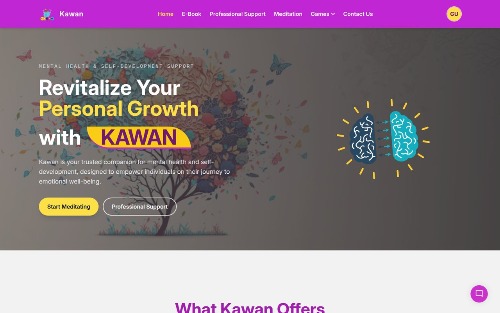 | 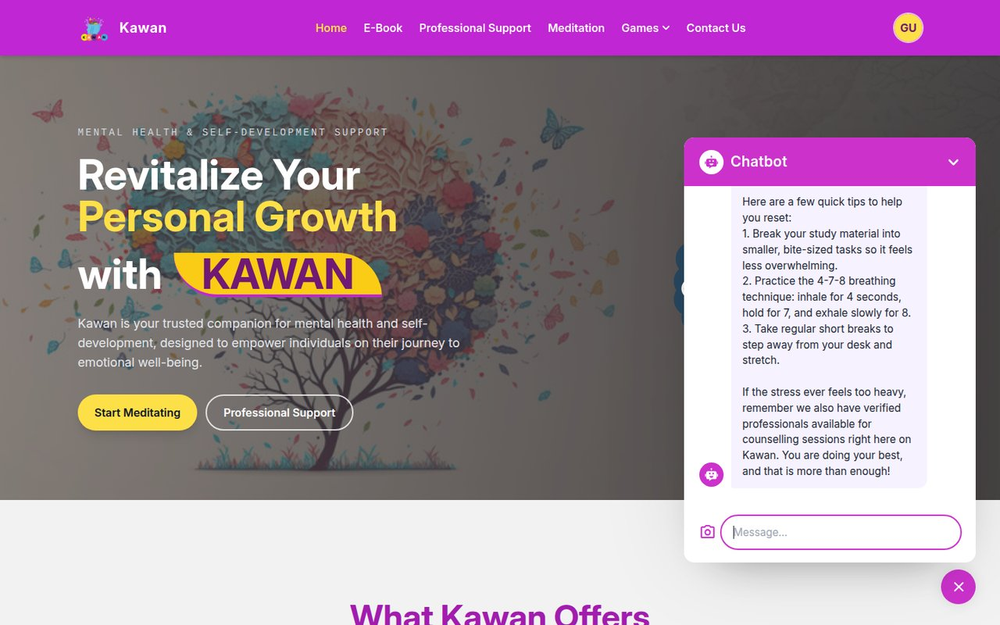 |
| **E-books** | **Meditation** |
| 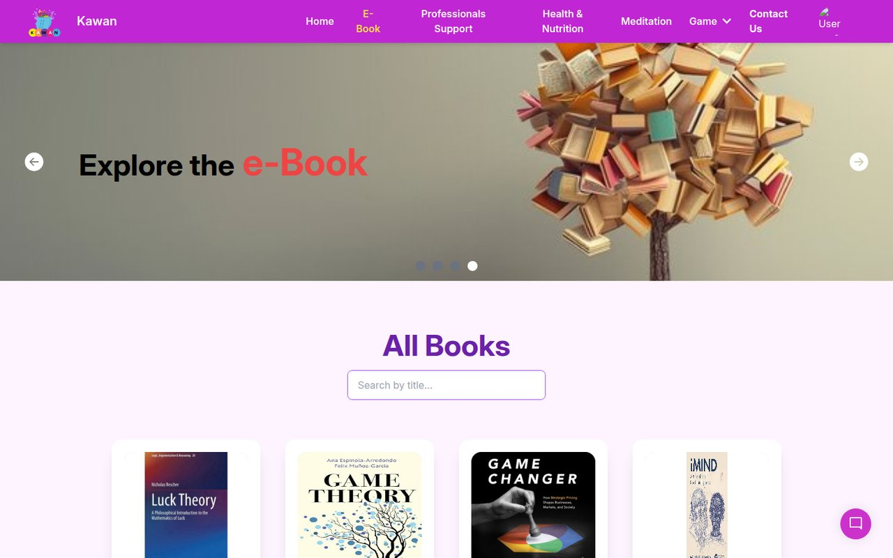 | 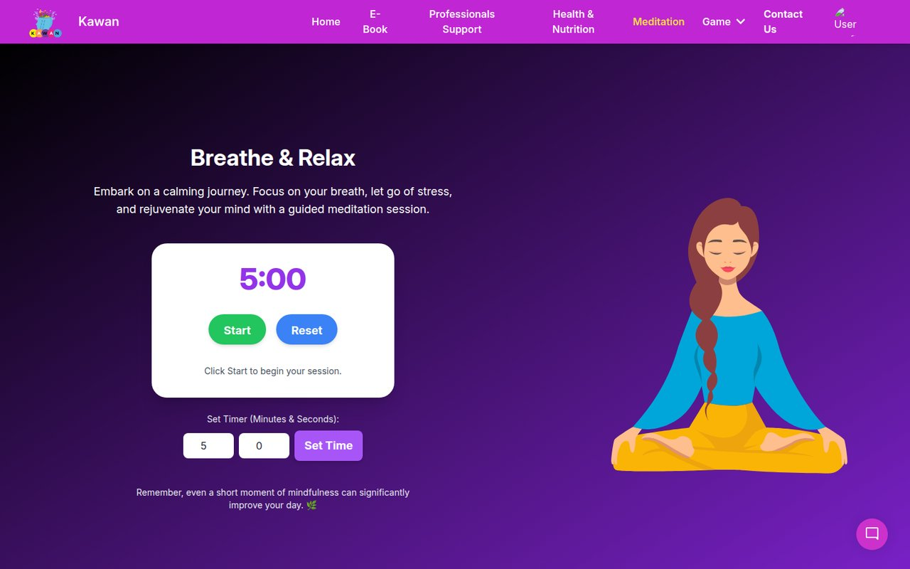 |

| Tic-Tac-Toe | 15 Puzzle | Kawan Puzzle |
|---|---|---|
| 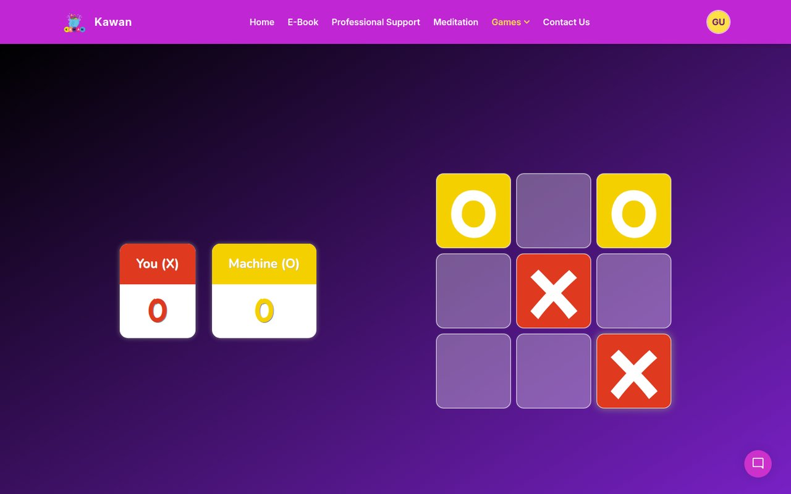 | 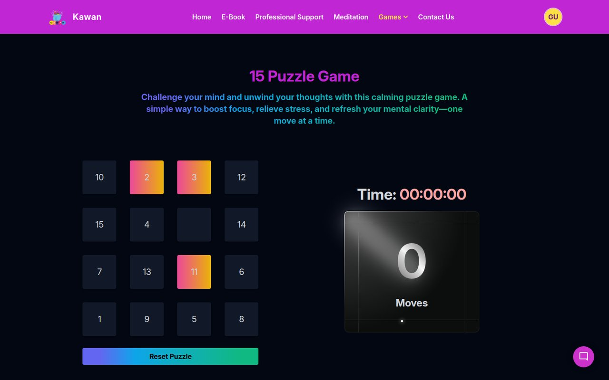 | 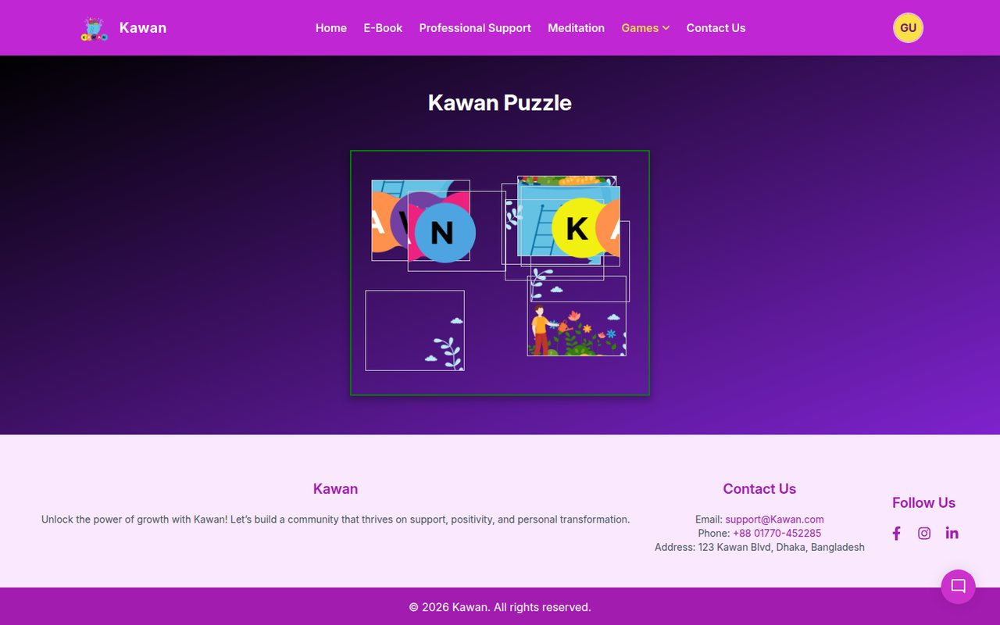 |

---

## Features

| Feature | Details |
|---|---|
| **AI Chatbot** | Empathetic Gemini-powered companion through `kawan-server`. Keeps conversation history, offers quick-reply suggestions, replies in the user's language, and handles timeouts and rate limits. |
| **Mood Check-in** | Face expression detection with **face-api.js**, fully **in the browser** (no image leaves the device). It averages a 4–10 s scan over many frames, shows the mood with a tip, keeps a local history, and can send the result to the chatbot for personal feedback. |
| **Professional Support** | Live 1:1 counselling on **VideoSDK**: device preview, create or join a meeting, mic/camera control, chat, screen share, raise hand, reactions, participant list, and HLS viewer mode. |
| **Professional Dashboard** | Professionals sign up as a professional. Their dashboard stays locked until an admin verifies them. |
| **E-Books & Audiobooks** | Book catalogue, details, read list / wish list, in-app reader and audio chapters. |
| **Meditation** | Guided breathing animation with a custom timer and an end-of-session alarm. |
| **Stress-relief Games** | Tic-tac-toe, 15-puzzle and a KAWAN jigsaw puzzle. |
| **Accounts** | Firebase email/password and Google sign-in, email verification, password reset, profile page and a guest demo login. |
| **Contact Us** | Messages are stored on the server and reviewed in the admin console. |

---

## Tech Stack

| Layer | Technology |
|---|---|
| UI framework | React 18, React Router v6 (data routers and loaders) |
| Build tool | Vite |
| Styling | Tailwind CSS + DaisyUI, Flowbite, Material Tailwind, Bootstrap (some sections) |
| Animation | Motion, AOS, React Spring, Lottie, tsParticles, React Type Animation |
| State / data | React Context (`AuthProvider`), TanStack React Query, Axios / fetch, localStorage |
| Auth | Firebase Authentication |
| Video | `@videosdk.live/react-sdk`, `hls.js` |
| Computer vision | `face-api.js` (Tiny Face Detector, 68-point tiny landmarks, expression net) |
| Reading | react-pdf, @react-pdf-viewer, react-reader (EPUB) |
| Feedback | react-hot-toast, react-toastify, SweetAlert2 |
| Hosting | Vercel (primary), Firebase Hosting |

---

## Architecture

### System context

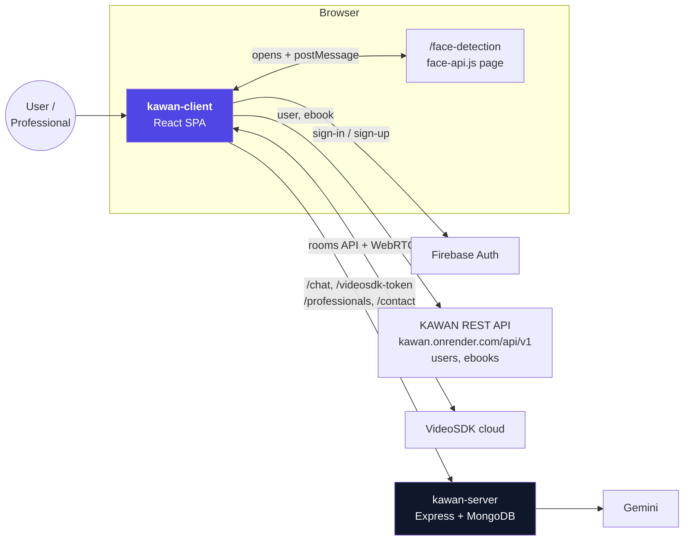

### Component architecture

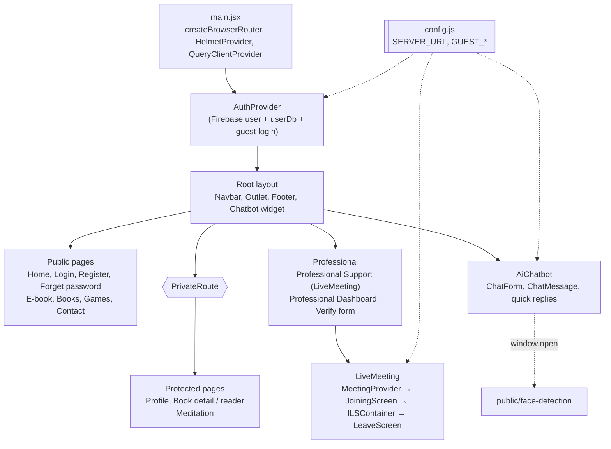

---

## Key Flows

### Authentication & role detection

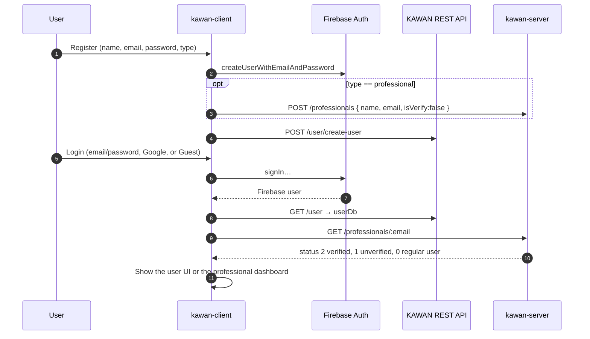

### Mood check-in → chatbot

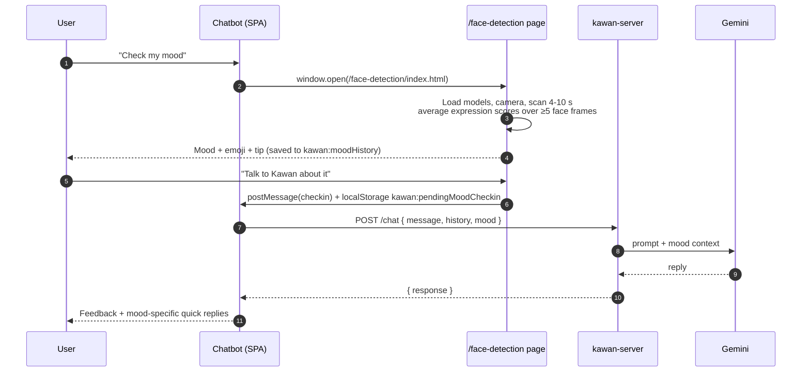

### Live counselling session

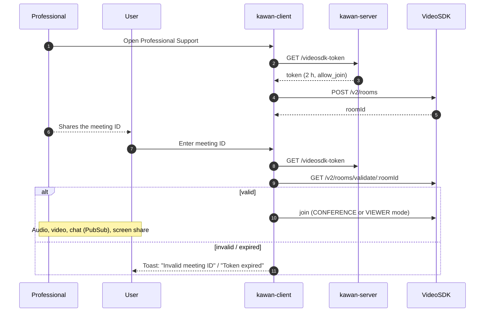

---

## Routes

| Path | Page | Access |
|---|---|---|
| `/` | Home: banner, offerings, how it works, stories, FAQ, chatbot | Public |
| `/login`, `/register`, `/forget-password` | Authentication | Public |
| `/profile` | User profile | Login required |
| `/professional-support` | Live video counselling | Public (meeting needs a token) |
| `/professional-dashboard` | Professional status and dashboard | Professional |
| `/professional-verify-form` | Verification form (placeholder, not built yet) | Professional |
| `/e-book`, `/books` | Book dashboard and catalogue | Public |
| `/books/:id`, `/book-read-listen/:id`, `/b1`, `/b2` | Book detail, reader and audio | Login required |
| `/meditation` | Guided breathing | Login required |
| `/game/tic-tac`, `/game/fifteen-puzzle`, `/game/kawan-puzzle` | Games | Public |
| `/contact-us` | Contact form | Public |
| `/face-detection/index.html` | Standalone mood check-in (static page) | Public |

Pages marked **Login required** are wrapped in `PrivateRoute`, which redirects to `/login` and returns to the page after login.

---

## Project Structure

```
kawan-client/
├── docs/screenshots/            # Images used in this README
├── public/
│   ├── face-detection/          # Standalone mood check-in page
│   │   ├── index.html
│   │   ├── script.js            # Scan, averaging, history, hand-off to the chatbot
│   │   ├── face-api.min.js
│   │   └── models/              # tiny_face_detector, face_landmark_68_tiny, face_expression
│   ├── assets/                  # Audio (chapters, meditation alarm)
│   ├── booksData.json
├── src/
│   ├── main.jsx                 # Router + providers
│   ├── config.js                # SERVER_URL, guest credentials
│   ├── firebase.init.js         # Firebase app from VITE_* env
│   ├── kawanInfo.js             # Platform facts given to the chatbot UI
│   ├── providers/AuthProvider.jsx
│   ├── routes/PrivateRoute.jsx
│   ├── utility/addToDb.js       # Read list / wish list in localStorage
│   └── components/
│       ├── AiChatbot/           # Chat UI, quick replies, mood hand-off
│       ├── LiveMeeting/         # VideoSDK app (api.jsx, meeting/, interactive-live-streaming/, hooks/)
│       ├── Professional*/       # Professional dashboard and verification
│       ├── EBook/, Audio/      # Books, reader, audiobook
│       ├── Meditation/
│       ├── Games/               # tic-tac-toe, FifteenPuzzle, KawanPuzzle
│       ├── Home/ Banner/ Navbar/ Footer/ FAQSecton/ …   # Landing page sections
│       └── Login/ Register/ ForgetPassword/ Profile/ ContactUs/ ErrorPage/
├── firebase.json, .firebaserc  # Firebase Hosting (SPA rewrite)
├── vercel.json                  # SPA rewrite → /index.html
├── tailwind.config.js, postcss.config.js, vite.config.js, eslint.config.js
└── .npmrc                       # legacy-peer-deps=true
```

---

## Getting Started

### Prerequisites

- Node.js 18+ and npm
- A Firebase project with **Email/Password** and **Google** sign-in enabled
- A running [kawan-server](https://github.com/mahfuzhasanreza/kawan-server) (local or deployed)

### Install & run

```bash
git clone https://github.com/mahfuzhasanreza/kawan-client.git
cd kawan-client
npm install          # .npmrc enables legacy-peer-deps
# create .env.local (see below)
npm run dev          # → http://localhost:5173
```

| Script | Purpose |
|---|---|
| `npm run dev` | Start the Vite dev server |
| `npm run build` | Production build into `dist/` |
| `npm run preview` | Serve the built app locally |
| `npm run lint` | Run ESLint |

> The mood check-in is a static page served by Vite at `http://localhost:5173/face-detection/index.html`, so no separate server is needed. The camera works only on `https://` or `localhost`.

---

## Environment Variables

Create `.env.local` in the project root:

```env
# --- Firebase (Console → Project settings → General → Your apps → SDK config) ---
VITE_apiKey=YOUR_FIREBASE_API_KEY
VITE_authDomain=YOUR_FIREBASE_AUTH_DOMAIN
VITE_projectId=YOUR_FIREBASE_PROJECT_ID
VITE_storageBucket=YOUR_FIREBASE_STORAGE_BUCKET
VITE_messagingSenderId=YOUR_FIREBASE_MESSAGING_SENDER_ID
VITE_appId=YOUR_FIREBASE_APP_ID

# --- Backend ---
VITE_SERVER_URL=http://localhost:5000        # prod: https://kawan-server.vercel.app

# --- Optional ---
VITE_GUEST_EMAIL=guest@kawan-demo.com        # demo account used by "Continue as Guest"
VITE_GUEST_PASSWORD=********
VITE_VIDEOSDK_TOKEN=                         # dev-only fallback if /videosdk-token is unreachable
```

> **Warning:** `VITE_*` variables are **built into the JavaScript bundle**, so anyone can read them. Never put real secrets here. The VideoSDK secret and the Gemini key belong on **kawan-server** only.
>
> Vite reads env vars **at build time**. Restart `npm run dev` or **redeploy** after changing them. `.env.local` is git-ignored.

---

## Deployment

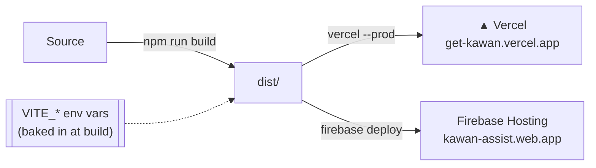

**Vercel (primary)**

```bash
vercel link        # existing project "kawan-client" (note: this overwrites .env.local, so back it up first)
vercel env add VITE_SERVER_URL production
vercel --prod
```

**Firebase Hosting**

```bash
npm run build
firebase deploy --only hosting     # project: kawan-assist
```

Both hosts rewrite every path to `/index.html` so client-side routes work after a refresh. After deploying to a **new domain**, add it to `CORS_ORIGINS` on kawan-server.

---

## Troubleshooting

| Symptom | Fix |
|---|---|
| CORS error calling the server | Add this site's origin to `CORS_ORIGINS` on kawan-server |
| Requests go to `localhost:5000` in production | `VITE_SERVER_URL` was not set when the app was built; set it and redeploy |
| `npm install` peer-dependency errors | Keep `.npmrc` (`legacy-peer-deps=true`) |
| Chatbot: *"taking longer than usual"* | Server cold start or a slow Gemini response (45 s client timeout); try again |
| *"Could not get a meeting token"* | kawan-server is down or missing `VIDEOSDK_*` env vars |
| Camera blocked in mood check / meeting | Use `https://` or `localhost` and allow camera permission |
| Google sign-in popup fails | Add the domain under Firebase → Authentication → Settings → Authorized domains |

---

## Known Limitations

- **The professional verification form is not built yet.** `ProfessionalDashboard/VerifyForm.jsx` is an empty component. The server endpoint for it (`POST /professionals-verify-request`) is ready.
- **No in-app booking.** Users can't send a counselling request from the UI yet. A professional creates a meeting and shares the meeting ID with the user outside the app. The server's `/req-counselling` and `/live` endpoints are ready for this.
- **Professional Support is not role-gated.** Anyone can open `/professional-support` and create or join a meeting.
- **Depends on a second backend.** User profiles and e-books come from `kawan.onrender.com`. On Render's free tier the first request after a quiet period can take up to about a minute.
- **No automated tests.**

---

## Related Repositories

| Repo | Description |
|---|---|
| [kawan](https://github.com/mahfuzhasanreza/kawan) | Monorepo: all apps as submodules, plus SRS, diagrams and research docs |
| **kawan-client** | ← you are here |
| [kawan-admin](https://github.com/mahfuzhasanreza/kawan-admin) | Admin console |
| [kawan-server](https://github.com/mahfuzhasanreza/kawan-server) | Express + MongoDB API |

---

## License

Released under the [MIT License](LICENSE).

---

## Author

**[Mahfuz Hasan Reza](https://github.com/mahfuzhasanreza)**, Team **Daimyoz**

<sub>Built to make mental health support accessible and approachable for everyone.</sub>
